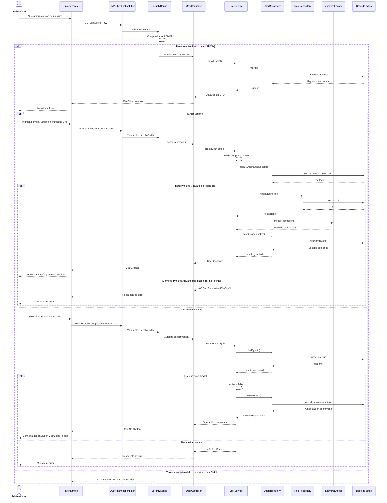

# Diagramas de secuencia — HU 01, 02, 03, 04 y 07

Estos diagramas corresponden a las historias del Sprint 1 identificadas en la [Matriz RACI SupaClothes v0.6](./Matriz_RACI_SupaClothes_v0.6.xlsx). Representan el flujo de la aplicación web y la API REST del MVP.

También están disponibles en formato editable de draw.io, con una página por HU: [Diagramas_Secuencia_SupaClothes.drawio](./Diagramas_Secuencia_SupaClothes.drawio).

## HU-01 — Inicio de sesión y acceso según rol

El usuario se autentica con sus credenciales. La interfaz conserva el JWT y el rol recibido para presentar las secciones permitidas; cada llamada protegida vuelve a validarse en el backend.

```mermaid
sequenceDiagram
    actor Usuario
    participant UI as Interfaz web
    participant API as AuthController
    participant Auth as AuthService
    participant AM as Spring AuthenticationManager
    participant UDS as UserDetailsService
    participant UR as UserRepository
    participant JWT as JwtService
    participant F as JwtAuthenticationFilter
    participant SEC as SecurityConfig

    Usuario->>UI: Ingresa usuario y contraseña
    UI->>API: POST /api/auth/login
    API->>Auth: login(credenciales)
    Auth->>AM: authenticate(usuario, contraseña)
    AM->>UDS: Cargar usuario para autenticar
    UDS->>UR: findByUsername(usuario)
    UR-->>UDS: Usuario, hash, estado y rol
    UDS-->>AM: UserDetails
    AM->>AM: Compara contraseña con hash BCrypt
    alt Credenciales válidas y cuenta activa
        AM-->>Auth: Autenticación exitosa
        Auth->>UR: findByUsername(usuario)
        UR-->>Auth: Usuario y rol
        Auth->>JWT: generateToken(usuario)
        JWT-->>Auth: JWT
        Auth-->>API: token, role y fullName
        API-->>UI: 200 OK + respuesta de autenticación
        UI->>UI: Guarda JWT y rol; muestra secciones del rol
        opt El usuario solicita una sección protegida
            UI->>F: Solicitud HTTP con token JWT
            F->>JWT: Extraer usuario y validar token
            F->>UDS: Cargar usuario actual
            UDS->>UR: findByUsername(usuario)
            UR-->>UDS: Usuario y autoridades
            UDS-->>F: Usuario activo y rol
            F->>SEC: Autorizar ruta y método para el rol
            alt Rol autorizado
                SEC-->>UI: Continúa la solicitud al recurso
            else Rol no autorizado
                SEC-->>UI: 403 Forbidden
            end
        end
    else Credenciales incorrectas o usuario desactivado
        AM-->>Auth: Fallo de autenticación
        Auth-->>API: Error de autenticación
        API-->>UI: 401 Unauthorized
        UI-->>Usuario: Muestra el error; no inicia sesión
    end
```

## HU-02 — Administración y desactivación de usuarios

La administración requiere el rol `ADMIN`. La desactivación es lógica: conserva el registro y su historial, pero impide futuros accesos.



## HU-03 — Administración de productos y variantes por SKU

El alta crea un producto con al menos una variante. Cada variante registra su SKU único, talla, color, precio, impuesto y stock mínimo; comienza con stock actual cero.

```mermaid
sequenceDiagram
    actor Admin as Administrador
    participant UI as Interfaz web
    participant F as JwtAuthenticationFilter
    participant SEC as SecurityConfig
    participant C as ProductController
    participant S as ProductService
    participant PR as ProductRepository
    participant VR as ProductVariantRepository
    participant DB as Base de datos

    Admin->>UI: Abre catálogo de productos
    UI->>F: GET /api/products + JWT
    F->>SEC: Valida token y rol
    SEC->>SEC: Autoriza lectura para ADMIN
    SEC->>C: Autoriza GET /api/products
    C->>S: getAllProducts()
    S->>PR: findAll()
    PR->>DB: Consultar productos y variantes
    DB-->>PR: Productos
    PR-->>S: Productos
    S-->>C: Productos
    C-->>UI: 200 OK + catálogo
    UI-->>Admin: Muestra catálogo

    Admin->>UI: Ingresa producto y una o más variantes
    UI->>F: POST /api/products + JWT + datos
    F->>SEC: Valida token y rol ADMIN
    SEC->>C: Autoriza creación
    C->>S: createProduct(producto, variantes)
    S->>S: Valida nombre, categoría y variantes presentes
    loop Por cada variante recibida
        S->>S: Valida SKU, talla, color, precio, impuesto y stock mínimo
        S->>S: Comprueba que el SKU no esté repetido en la solicitud
        S->>VR: findBySku(SKU)
        VR->>DB: Consultar unicidad del SKU
        DB-->>VR: Resultado
        VR-->>S: SKU disponible o registrado
    end
    alt Producto y SKUs válidos y disponibles
        S->>S: Crea variantes activas con stock actual 0
        S->>PR: save(producto con variantes)
        PR->>DB: Insertar producto y variantes
        DB-->>PR: Producto persistido
        PR-->>S: Producto guardado
        S-->>C: Producto y variantes
        C-->>UI: 201 Created
        UI-->>Admin: Confirma alta y actualiza catálogo
    else Datos inválidos, sin variantes o SKU duplicado
        S-->>C: 400 Bad Request o 409 Conflict
        C-->>UI: Respuesta de error
        UI-->>Admin: Muestra el error; no confirma el alta
    end

    opt Gestionar cambios de producto o variante
        Admin->>UI: Guarda cambios
        alt Editar datos del producto
            UI->>F: PUT /api/products/{id} + JWT + datos
            F->>SEC: Valida token y rol ADMIN
            SEC->>C: Autoriza actualización del producto
            C->>S: updateProduct(id, datos)
            S->>PR: findById(id)
            PR->>DB: Buscar producto
            DB-->>PR: Producto
            PR-->>S: Producto
            S->>PR: save(producto actualizado)
            PR->>DB: Actualizar datos del producto
            DB-->>PR: Producto actualizado
            PR-->>S: Producto actualizado
        else Agregar variante
            UI->>F: POST /api/products/{id}/variants + JWT + datos
            F->>SEC: Valida token y rol ADMIN
            SEC->>C: Autoriza creación de variante
            C->>S: addVariant(productId, datos)
            S->>PR: findById(productId)
            PR->>DB: Buscar producto
            DB-->>PR: Producto
            PR-->>S: Producto
            S->>VR: findBySku(SKU)
            VR->>DB: Comprobar unicidad del SKU
            DB-->>VR: Resultado
            VR-->>S: SKU disponible o registrado
            S->>PR: save(producto con variante)
            PR->>DB: Insertar variante
            DB-->>PR: Producto actualizado
            PR-->>S: Producto actualizado
        else Editar variante
            UI->>F: PUT /api/products/{productId}/variants/{variantId} + JWT + datos
            F->>SEC: Valida token y rol ADMIN
            SEC->>C: Autoriza actualización de variante
            C->>S: updateVariant(productId, variantId, datos)
            S->>PR: findById(productId)
            PR->>DB: Buscar producto y variantes
            DB-->>PR: Producto
            PR-->>S: Producto
            S->>VR: existsBySkuAndIdNot(SKU, variantId)
            VR->>DB: Comprobar unicidad si cambió el SKU
            DB-->>VR: Resultado
            VR-->>S: SKU disponible o registrado
            S->>PR: save(producto con variante actualizada)
            PR->>DB: Actualizar variante
            DB-->>PR: Producto actualizado
            PR-->>S: Producto actualizado
        end
        S-->>C: Producto actualizado
        C-->>UI: 200 OK + producto actualizado
    end

    opt Desactivar variante
        Admin->>UI: Desactiva una variante
        UI->>F: PATCH /api/products/{productId}/variants/{variantId}/deactivate + JWT
        F->>SEC: Valida token y rol ADMIN
        SEC->>C: Autoriza desactivación
        C->>S: deactivateVariant(productId, variantId)
        S->>PR: Busca producto y variante
        PR->>DB: Consultar producto y variantes
        DB-->>PR: Producto y variantes
        PR-->>S: Producto y variante
        S->>PR: save(producto con variante inactiva)
        PR->>DB: Actualizar estado de variante
        DB-->>PR: Producto actualizado
        PR-->>S: Producto actualizado
        S-->>C: Producto actualizado
        C-->>UI: 200 OK + producto actualizado
    end

    opt Desactivar producto
        Admin->>UI: Desactiva producto
        UI->>F: PATCH /api/products/{id}/deactivate + JWT
        F->>SEC: Valida token y rol ADMIN
        SEC->>C: Autoriza desactivación
        C->>S: deactivateProduct(id)
        S->>PR: findById(id)
        PR->>DB: Buscar producto
        DB-->>PR: Producto
        PR-->>S: Producto
        S->>S: Desactiva también sus variantes
        S->>PR: save(producto inactivo)
        PR->>DB: Actualizar estados
        DB-->>PR: Producto inactivo
        PR-->>S: Producto inactivo
        S-->>C: Producto inactivo
        C-->>UI: 200 OK + producto inactivo
    end

    Note over S,UI: Errores de validación o SKU duplicado se devuelven al cliente como 400 Bad Request o 409 Conflict
```

## HU-04 — Registro trazable de entradas de inventario

`ADMIN` y `BODEGA` pueden registrar entradas. El movimiento conserva el SKU, usuario, cantidad, stock anterior y resultante, referencia y fecha.

```mermaid
sequenceDiagram
    actor Operador as Administrador o Bodega
    participant UI as Interfaz web
    participant F as JwtAuthenticationFilter
    participant SEC as SecurityConfig
    participant C as InventoryController
    participant S as InventoryService
    participant VR as ProductVariantRepository
    participant UR as UserRepository
    participant MR as InventoryMovementRepository
    participant DB as Base de datos

    Operador->>UI: Ingresa SKU, cantidad y referencia
    UI->>F: POST /api/inventory/entries + JWT + datos
    F->>SEC: Valida token y usuario activo
    SEC->>SEC: Autoriza rol ADMIN o BODEGA
    alt Token válido y rol permitido
        SEC->>C: Autoriza registro de entrada
        C->>C: Obtiene username del Principal
        C->>S: registerEntry(datos, username)
        S->>S: Valida SKU, cantidad positiva y referencia
        S->>VR: findBySkuForUpdate(SKU)
        VR->>DB: Buscar y bloquear variante por SKU
        DB-->>VR: Variante
        VR-->>S: Variante encontrada
        alt Variante activa y datos válidos
            S->>UR: findByUsername(username)
            UR->>DB: Buscar usuario que registra la entrada
            DB-->>UR: Usuario
            UR-->>S: Usuario
            S->>S: Calcula stock anterior y stock resultante
            S->>VR: Actualiza currentStock
            VR->>DB: Persistir nuevo stock
            S->>S: Construye movimiento ENTRADA con usuario y referencia
            S->>MR: save(movimiento)
            MR->>DB: Persistir movimiento trazable
            DB-->>MR: Movimiento guardado
            MR-->>C: Movimiento
            C-->>UI: 201 Created + movimiento
            UI-->>Operador: Confirma la entrada
            Note over UI: La interfaz refresca existencias y movimientos con sus endpoints GET
        else SKU inexistente, variante inactiva o datos inválidos
            S-->>C: 400 Bad Request, 404 Not Found o 409 Conflict
            C-->>UI: Respuesta de error
            UI-->>Operador: Muestra el error; no registra la entrada
        end
    else Sin autenticación o rol no permitido
        SEC-->>UI: 401 Unauthorized o 403 Forbidden
    end
```

## HU-07 — Registro de venta, cálculos y descuento automático de stock

La venta reserva las variantes mientras valida cada SKU y calcula subtotales e impuestos. La venta, los pagos y los movimientos de salida se guardan dentro de una transacción: un error revierte los cambios de stock. La captura y validación del pago aparecen porque forman parte del contrato actual de `POST /api/sales`; la HU de pago correspondiente sigue siendo HU-08 en la matriz. La consulta y la impresión del comprobante pertenecen a HU-10 y no se detallan aquí.

```mermaid
sequenceDiagram
    actor Vendedor
    participant UI as Interfaz web
    participant F as JwtAuthenticationFilter
    participant SEC as SecurityConfig
    participant C as SaleController
    participant S as SaleService
    participant UR as UserRepository
    participant VR as ProductVariantRepository
    participant SR as SaleRepository
    participant MR as InventoryMovementRepository
    participant PayR as PaymentRepository
    participant DB as Base de datos

    Vendedor->>UI: Selecciona artículos por SKU y cantidad
    UI->>UI: Calcula estimado de subtotales e impuestos
    Vendedor->>UI: Confirma venta y datos de pago
    UI->>F: POST /api/sales + JWT + artículos y pago
    F->>SEC: Valida token y usuario activo
    SEC->>SEC: Autoriza rol ADMIN o VENDEDOR
    alt Token válido y rol permitido
        SEC->>C: Autoriza creación de venta
        C->>S: createSale(solicitud, username)
        S->>S: Valida que haya artículos y datos de pago
        S->>UR: findByUsername(username)
        UR->>DB: Buscar vendedor
        DB-->>UR: Vendedor
        UR-->>S: Vendedor
        loop Por cada artículo SKU/cantidad
            S->>VR: findBySkuForUpdate(SKU)
            VR->>DB: Buscar y bloquear variante
            DB-->>VR: Variante y stock actual
            VR-->>S: Variante
            S->>S: Valida SKU, estado activo y stock suficiente
            S->>S: Calcula subtotal, impuesto y total de línea
            S->>S: Guarda datos históricos de la línea
            S->>S: Descuenta cantidad del stock en memoria
            S->>VR: save(variante con stock actualizado)
            VR->>DB: Actualizar stock
            S->>S: Prepara movimiento SALIDA_VENTA
        end
        S->>S: Calcula subtotal, impuestos y total de venta
        S->>S: Valida método e importe recibido; calcula cambio
        alt Artículos, stock y pago válidos
            S->>SR: save(venta confirmada)
            SR->>DB: Persistir venta y líneas
            DB-->>SR: Venta con ID y comprobante
            loop Por cada movimiento de salida
                S->>MR: save(movimiento con saleId)
                MR->>DB: Persistir movimiento trazable
            end
            S->>PayR: save(pago y cambio)
            PayR->>DB: Persistir pago
            DB-->>S: Transacción confirmada
            S-->>C: Venta registrada
            C-->>UI: 201 Created + venta, total y número de comprobante
            UI-->>Vendedor: Muestra total y número de comprobante
            Note over UI: La interfaz refresca el catálogo/stock y los movimientos con sus endpoints GET
        else SKU/estado inválido, stock insuficiente o pago no válido
            Note over S,DB: La excepción revierte la transacción, incluido el stock descontado
            S-->>C: 400 Bad Request, 404 Not Found o 409 Conflict
            C-->>UI: Error de validación
            UI-->>Vendedor: Muestra el error y conserva la venta sin confirmar
        end
    else Sin autenticación o rol no permitido
        SEC-->>UI: 401 Unauthorized o 403 Forbidden
    end
```
